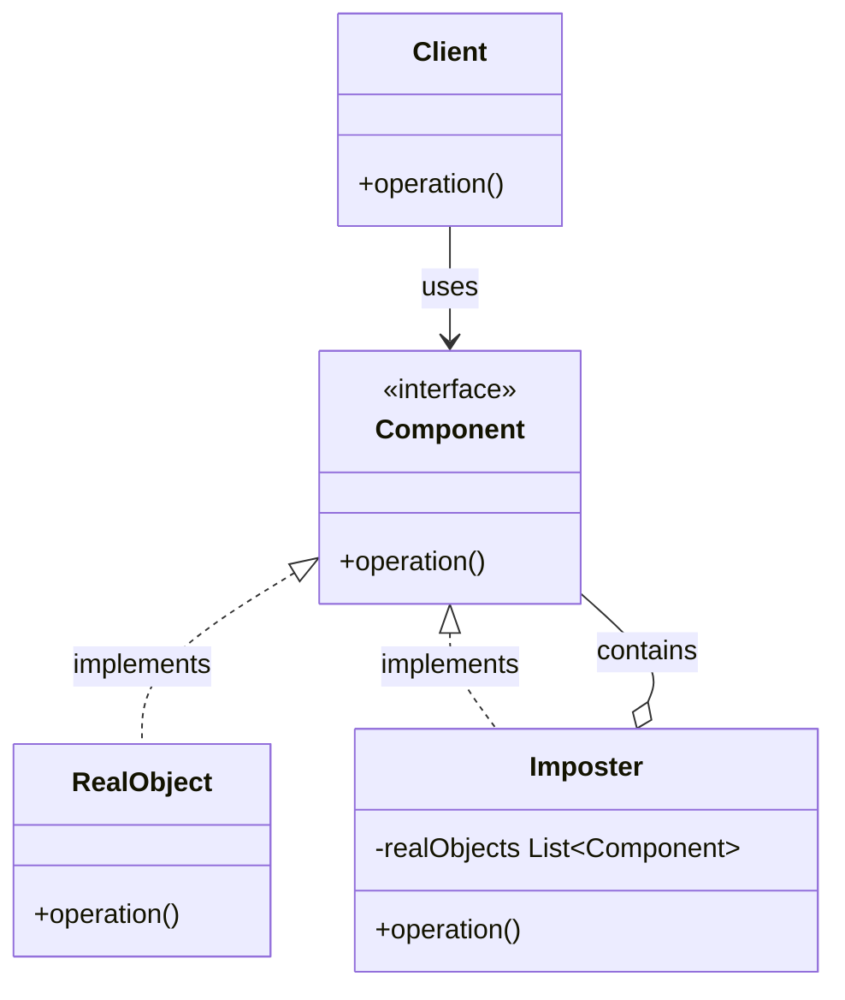

## TL;DR

- 多国通貨の計算を「式」のメタファーで捉え、同じインタフェースを持つ別のオブジェクトに計算を委譲する Imposter パターンで設計した。
- 為替の換算の責務は、`Expression` ではなく専用の `Bank` オブジェクトに持たせた。

## 内容

### 本章でやったこと

大きいテストを、進み具合が分かるように小さいテストに分けた。また、計算を表すためのメタファーを 2 つ検討した。

1. 財布: さまざまな通貨や額面の紙幣が入った財布に見立てる
2. 式: `$5 + 10CHF` のような多通貨の計算を、数式の評価に見立てる

そして、メタファーを使って最初に書いたテスト（`testSimpleAddition`）を書き直した。

設計の方針が明確でない場合は、これまでの章と同じく、テスト、仮実装、リファクタリングのサイクルを回す。方針が明確な場合は、速度を上げてもよい（[[テスト駆動開発（書籍） 第9章 歩幅の調整|第9章 歩幅の調整]]）。

### 多国通貨の計算の難しさ

この問題の難しさは、複数の通貨を扱っていることを意識させないコードにしたい点にある。いちばん簡単なのは、すべてを基準通貨（たとえば US ドル）に換算することである。しかし、この方法では為替レートをうまく扱えない。そこで、為替レートを簡単に扱えて、計算が計算のように見えるようにしたい。これを解決するために、同じ[[interface|インタフェース]]を持つ新しいオブジェクト（Imposter）に計算処理を委譲する。

TDD はこのような優れた設計を保証するものではなく、結局はひらめきが必要である。ただし、テストとリファクタリングで手入れされたコードがあることで、ひらめきやそれを実現することを助けてくれる。

### Imposter パターン

Imposter（インポスター）は「なりすまし」という意味である。既存のオブジェクトが望む振る舞いをしないときに使う。同じインタフェースを持ちながら異なる実装を持つ別のオブジェクト（Imposter）を作り、そちらに処理を委譲する。

[[null-object-pattern|Null Object パターン]]（「何もしない」実装を差し込む）や [[composite-pattern|Composite パターン]]（リストを単一のオブジェクトに見せる）も、Imposter の一種である。

本章では、`Money.plus()` の戻り値の型を `Expression` にし、`Money` が `Expression` を実装するようにした。

### 換算の責務を Bank に持たせる理由

換算の責務は `Expression` に持たせてもよいが、次の 2 つの理由から専用の `Bank` オブジェクトを作った。

1. `Expression` は今回の実装の中心となるロジックを担いそうである。中心となるオブジェクトは責務を絞ったほうがよい。そうすることで、柔軟性、テスト容易性、再利用性が高まり、[[cognitive-load|認知的負荷]]も減らせる
2. 今後、四則演算をはじめとするさまざまな演算の実装が控えているので、`Expression` が肥大化しそうである

## キーワード

- [[test-driven-development|テスト駆動開発]]
- [[interface|インタフェース]]
- [[null-object-pattern|Null Object パターン]]
- [[composite-pattern|Composite パターン]]
- [[single-responsibility-principle|単一責任の原則]]
- [[cognitive-load|認知的負荷]]

## 自分の理解

財布のメタファーは概念を理解するためのもので、実際の実装は式のメタファーで進む。

「複数の通貨を扱っていることを意識させないコードにしたい」という要件がどこから出てきたのか疑問だったが、「はじめに」にあった加重平均の話のあたりだろう。

基準通貨に換算すると為替レートをうまく扱えないのはなぜか。換算すると、いつのレートで換算したかという情報が失われるからだと理解した。たとえばレートを `2CHF = 1USD` として `$5 + 10CHF` を計算すると、`$5 + $5 = $10` になる。計算した時点で `10CHF` という情報は消えるので、後でレートが `3CHF = 1USD` に変わっても、`$10` という値しか残っておらず換算し直せない。つまり評価が早すぎるのが問題なので、[[lazy-evaluation|遅延評価]]にすればよいということだろう。

それにしても、Imposter に委譲するという設計は思いつけるだろうか。

`Expression` は今のところ空のインタフェースなので、後からここにメソッドを追加していくのだろう。

`Expression` の責務を絞る理由は、要するに[[single-responsibility-principle|単一責任の原則]]である。
