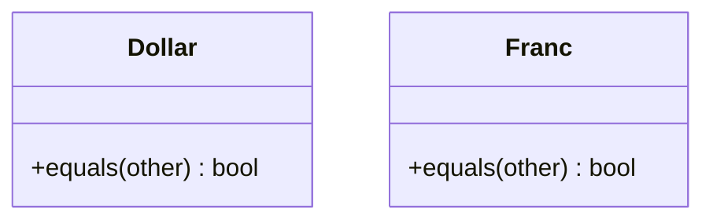
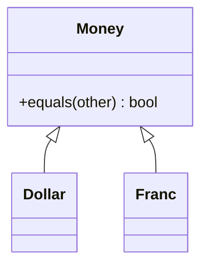

## TL;DR

- 2 つのクラスで重複していたメソッドを、新しく作った親クラスに引き上げた。
- テスト不足に気づいたら、リファクタリングの前に本来あるべきテストを追加する。

## 内容

### 本章でやったこと

`Dollar` と `Franc` で重複していた `equals` メソッドを、新しく定義した親クラス `Money` に引き上げた。この[[refactoring|リファクタリング]]の手法は、Martin Fowler のリファクタリングの本にも「メソッドの引き上げ（Pull Up Method）」として出てくる。

変更前は、2 つのクラスがそれぞれ `equals` を持っていた。

変更後は、`Money` が `equals` を持ち、`Dollar` と `Franc` がそれを継承する。

### テスト不足に気づいたら

テスト不足に気づいたら、リファクタリングの前に本来あるべきテストを追加する。サンプルコードでは、`Franc` クラスの `equals` メソッドのテストが足りていなかった。テストがなければリファクタリングはできず、その結果、設計は次第に腐っていく。

## キーワード

- [[refactoring|リファクタリング]]
- [[inheritance|継承]]
- [[test-driven-development|テスト駆動開発]]

## 自分の理解

### 継承を安易に選んでいないか

この章では[[inheritance|継承]]を使っているが、一般には[[composition-over-inheritance|継承より委譲]]と言われる。今回のケースは一見すると継承でもよさそうに見える。is-a の関係としては自然であり、親クラスの実装の変更がサブクラス全体に影響する問題も、今の時点では起こりえない。

それでも、継承にはデメリットが多い。

- is-a の関係にするということは、[[coupling|結合度]]が高く変更に弱いということである
- サブクラスは、言語によっては親クラスの `protected` や `private` のフィールドにアクセスでき、[[encapsulation|カプセル化]]を壊す
- [[liskov-substitution-principle|リスコフの置換原則]]を守り続けるのは非常に難しい。守れなければ、利用者が想定しない挙動によるバグが起こりうる。呼び出し元でクラスを判定する必要が出てくるので、[[open-closed-principle|オープン・クローズドの原則]]にも違反しやすくなる
- 継承関係はコンパイル時に静的に決まる

特に今回のケースでは、Effective Java でも論じられている次の問題も起こる。

> 継承可能なクラスで `equals` を実装すると、対称性・推移性・リスコフの置換原則のいずれかを必ず壊す

対称性とは「`x.equals(y)` が `true` ならば `y.equals(x)` も `true`」、推移性とは「`x.equals(y)` と `y.equals(z)` が `true` ならば `x.equals(z)` も `true`」という性質である。等価性は二項関係なので、2 つのオペランドのどちらの型を基準にするかを一意に決められない。親クラスから見れば、サブクラス特有のフィールドは無視すべき余分な情報である。一方、サブクラスから見れば、そのフィールドは等価性の本質的な一部である。この 2 つを同時に満たそうとすると矛盾が生じる。

とはいえ、これはあくまで設計の途中である。通貨の種類ごとにクラスを作るとサブクラスが爆発的に増えるので、最終的には has-a の関係（`Record<int amount, int currency>` のような値の合成）に置き換わったはずである（うろ覚え）。

なお、Pull Up Method は以前に読んだ『リファクタリング：Ruby エディション』でも出てきた。
