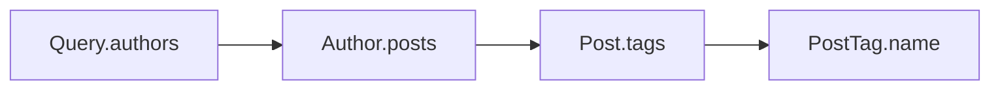
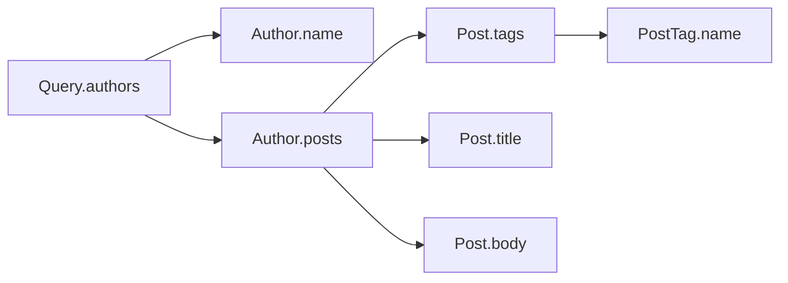

## TL;DR

Apollo が開発した、[[graphql|GraphQL]] サーバを実装するための OSS ライブラリ。[[graphql-schema|GraphQL Schema]] と [[graphql-resolver|Resolver]] を渡すだけでサーバを立ち上げられる。

## 仕組み

### Resolver の定義

次のような GraphQL Schema を例にする。

```graphql
type PostTag {
  name: String!
}

type Post {
  id: ID!
  title: String!
  body: String!
  tags: [PostTag]!
}

interface User {
  name: String!
}

type Author implements User {
  name: String!
  posts: [Post]!
}

type Query {
  authors: [Author!]!
}
```

Resolver は `parent`、`args`、`context`、`info` の 4 つの引数を受け取る関数である。

- `parent`: 親の Resolver の戻り値。ルートの Resolver の直下では空になる
- `args`: GraphQL Schema で定義したフィールドの引数
- `context`: GraphQL の操作全体で共有されるオブジェクト。DB コネクションやユーザの認証情報など、任意のデータを持たせられる
- `info`: 実行される操作の詳細。デバッグやエラー通知のメッセージを作るときに使う

各フィールドで返す値は、GraphQL Schema で定義した型と一致させる必要がある。

```ts
const resolvers = {
  Query: {
    authors: () => Object.entries(db.users).map(([id, user]) => ({ id, ...user })),
  },
  Post: {
    tags: ({ tags }) => tags.map((name) => ({ name })),
  },
  Author: {
    posts: ({ id }) =>
      Object.entries(db.blogs)
        .filter(([_, post]) => post.author === id)
        .map(([id, post]) => ({ id, ...post })),
  },
}
```

### Default resolvers

Resolver を定義していないフィールドには、Apollo Server が Default resolvers を適用する。これは、親のオブジェクトがフィールド名と同じプロパティを持っていれば、その値を返す。そのため `Post.title` や `Author.name` は、Resolver を定義しなくても期待どおりの値を返す。

### サーバの起動

`startStandaloneServer` を使うと、簡単にサーバを立ち上げられる。下の例では、Resolver を追加した GraphQL Schema を `ApolloServer` に渡している。Schema ファイルの読み込み方は [[graphql-schema-typescript-loading|GraphQL Schema ファイルを TypeScript で読み込む]] にまとめた。

```ts
import { addResolversToSchema } from "@graphql-tools/schema"
import { ApolloServer } from "@apollo/server"
import { startStandaloneServer } from "@apollo/server/standalone"

const schemaWithResolvers = addResolversToSchema({ schema, resolvers })
const apolloServer = new ApolloServer({ schema: schemaWithResolvers })

const { url } = await startStandaloneServer(apolloServer)
console.log(url)
```

表示された `url` を開くと、Apollo Sandbox というプレイグラウンド環境が起動する。

### Resolver chains

Resolver chains は、ルートの Resolver から GraphQL Schema の最下層の Resolver まで処理が連鎖する仕組みと、その実行順序のことである。順序はパーサが生成する [[abstract-syntax-tree|AST]] をもとに自動で決まるので、クライアントが指定したクエリを正しい順序で取得して返せる。生成される AST は [[ast-explorer|AST explorer]] で確かめられる。

また、GraphQL サーバは AST と GraphQL Schema を比べて、クエリが有効かを確かめる。無効なクエリには、Resolver を実行せずにエラーを返す。

## 例

次のクエリでは、Resolver が一直線に実行される。

```graphql
query GetPosts {
  authors {
    posts {
      tags {
        name
      }
    }
  }
}
```



複数のフィールドを取得すると、チェーンが分岐する。分岐したそれぞれのサブチェーンの Resolver は並列に実行される。

```graphql
query GetPosts {
  authors {
    name
    posts {
      title
      body
      tags {
        name
      }
    }
  }
}
```



%%

## 自分の理解

つまずいた点、腑に落ちたきっかけ。書くときはこのコメントを外す
%%

## 関連

- [[graphql|GraphQL]]
- [[graphql-schema|GraphQL Schema]]
- [[graphql-resolver|Resolver]]
- [[apollo-client|Apollo Client]]

## 出典

- [Apollo Server](https://www.apollographql.com/docs/apollo-server/)
- [Resolvers - Apollo Server](https://www.apollographql.com/docs/apollo-server/data/resolvers)
