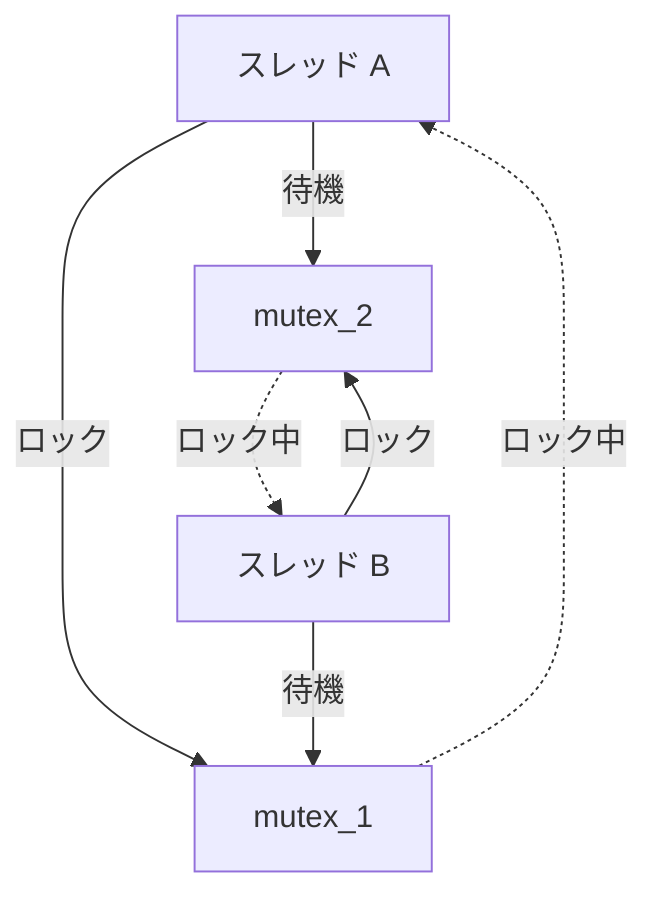

## TL;DR

複数の[[thread|スレッド]]や[[process|プロセス]]が互いにリソースの解放を待つことで、どの処理も進まなくなる状態。

## 仕組み

デッドロックが起きるには、[[coffman-conditions|Coffman conditions]] の 4 つの条件がすべてそろう必要がある。

## 例

[[mutex|mutex]] では、次の順で処理が進むとデッドロックが起きる。

1. スレッド A が `mutex_1` をロックする
2. スレッド B が `mutex_2` をロックする
3. スレッド A が `mutex_2` を取得しようとするが、スレッド B がロックしているので待つ
4. スレッド B が `mutex_1` を取得しようとするが、スレッド A がロックしているので待つ

[[go|Go]] でチャネルを使ったときの例は、[[Go言語で学ぶ並行プログラミング　他言語にも適用できる原則とベストプラクティス 第11章 チャネルでのデッドロック|チャネルでのデッドロック]]にある。

## 注意点

回避策は[[Go言語で学ぶ並行プログラミング　他言語にも適用できる原則とベストプラクティス 第11章 デッドロックに対処する 4 つの方法|デッドロックに対処する 4 つの方法]]にまとめている。

%%

## 自分の理解

つまずいた点、腑に落ちたきっかけ。書くときはこのコメントを外す
%%

## 関連

- [[coffman-conditions|Coffman conditions]]
- [[resource-allocation-graph|Resource Allocation Graph]]
- [[mutex|mutex]]

## 出典

- [デッドロック - Wikipedia](https://ja.wikipedia.org/wiki/デッドロック)
