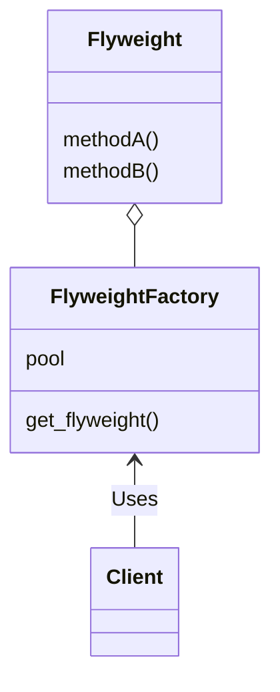

## TL;DR

生成したオブジェクトを効率よく共有することで、リソースの消費を抑える[[design-pattern|デザインパターン]]。

## なぜ必要か

同じオブジェクトを何度も生成せずに使い回すので、生成されるオブジェクトの数とリソースの消費を抑えられる。

## 仕組み

`Flyweight` は共有されるオブジェクトで、環境や状況によって変わらない情報だけを持つ。`FlyweightFactory` は、内部の `pool` に `Flyweight` のインスタンスを持っている。`get_flyweight` で要求されたとき、そのインスタンスがあればそれを返し、なければ新しく生成して返す。`FlyweightFactory` 自体には [[singleton-pattern|Singleton パターン]]が使われる。

## 注意点

オブジェクトを共有するので、環境や状況によって変わらないリソースにしか使えない。共有されるオブジェクトが変更されると、思わぬバグを生むことがある。また、コードが複雑になり、理解しにくくなる。

## 関連

- [[singleton-pattern|Singleton パターン]]
- [[design-pattern|デザインパターン]]
