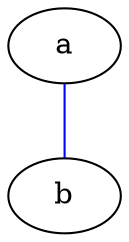

## TL;DR

オープンソースのグラフ可視化ソフトウェア。構造的な情報を、抽象的なグラフやネットワークの図として表す。

## 仕組み

グラフの構造をテキストの言語（DOT 言語）で記述し、`dot`、`neato`、`fdp`、`sfdp`、`circo`、`twopi` などのレイアウトプログラムに渡すと図ができる。出力は画像、Web ページ用の SVG、ほかの文書に埋め込むための PDF や PostScript など、40 以上の形式に対応している。

公式サイトでは、主な用途としてソフトウェア工学、データベースや Web の設計、ネットワークを挙げている。

## 例

DOT 言語では、有向グラフを `digraph`、無向グラフを `graph` で書き、辺をそれぞれ `->` と `--` で表す。色やラベルなどの属性は `[color=blue]` のように角括弧で付ける。`strict` を付けると、同じノードの間の重複した辺が 1 本にまとめられる。次の例では、`a` と `b` の間に青い辺が 1 本だけ描かれる。

ノードと辺をまとめるにはサブグラフを使う。名前が `cluster` で始まるサブグラフは、レイアウトエンジンによっては枠で囲んだまとまりとして描かれる。

%%

## 自分の理解

つまずいた点、腑に落ちたきっかけ。書くときはこのコメントを外す
%%

## 出典

- [Graphviz](https://graphviz.org/)
- [About - Graphviz](https://graphviz.org/about/)
- [DOT Language - Graphviz](https://graphviz.org/doc/info/lang.html)
