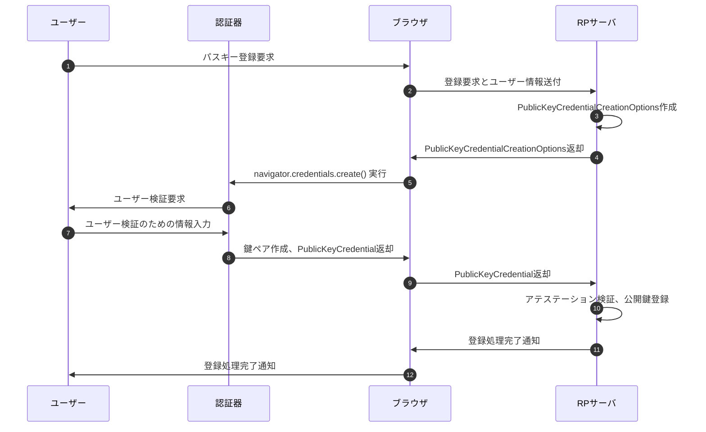
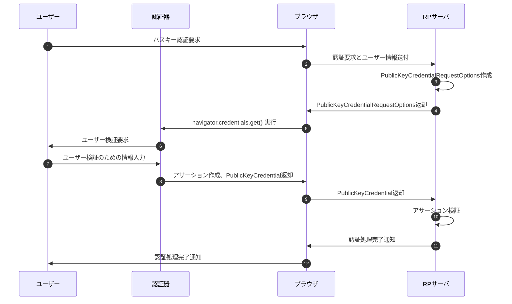

## TL;DR

従来のパスワード認証に代わる認証方式。ユーザはパスワードを入力する代わりに、生体認証や PIN を使ってサービスにログインできる。FIDO アライアンスと [[w3c|W3C]] が共同で標準化した [[fido2|FIDO2]] に基づいている。

## 仕組み

FIDO2 は、生体認証に公開鍵暗号を用いるパスワードレス認証の技術で、2 つの仕様から成る。W3C が策定した [[webauthn|WebAuthn]] は、FIDO2 の認証を Web ブラウザから使うための API 仕様である。FIDO アライアンスが策定した [[ctap|CTAP]] は、認証器とブラウザの間の通信プロトコルである。認証器とは、秘密鍵を生成・保管し、生体認証や PIN で本人確認をするデバイスや機能（iPhone など）を指す。

処理は「登録」と「認証」の 2 つに分けられる。ユーザがログインしようとしているアプリケーションを Relying Party（RP）と呼ぶ。

### 登録

ブラウザは RP から受け取った `PublicKeyCredentialCreationOptions` を `navigator.credentials.create()` に渡す。このオブジェクトには、推測が難しいランダムな `challenge`（16 バイト以上を推奨）、RP とユーザの識別子、使う暗号アルゴリズムなどが入る。認証器はユーザを検証したあと鍵ペアを作り、秘密鍵を内部に保持して、公開鍵を `PublicKeyCredential` として返す。このときのレスポンス `AuthenticatorAttestationResponse` には、正規の認証器であることを証明するアテステーションが、[[cbor|CBOR]] でエンコードされて入っている。RP はアテステーションを検証し、公開鍵を登録する。

### 認証

ブラウザは `PublicKeyCredentialRequestOptions` を `navigator.credentials.get()` に渡す。認証器はユーザを検証したあと、秘密鍵で `challenge` に署名し、`AuthenticatorAssertionResponse` を含む `PublicKeyCredential` を返す。RP は登録済みの公開鍵でこのアサーションを検証し、ユーザが秘密鍵を持つ本人であることを確かめる。

上の 2 つの図は、[Software Design 2025年1月号](https://gihyo.jp/magazine/SD/archive/2025/202501) の図を一部改変したもの。

## 例

[[go|Go]] で RP サーバを実装したサンプルを [passkey-demo-golang](https://github.com/radish-miyazaki/passkey-demo-golang) に置いた。RP サーバ側の処理の大部分は [go-webauthn](https://github.com/go-webauthn/webauthn) に任せている。

## 自分の理解

FIDO は「ファイド」と読むらしい。

## 関連

- [[webauthn|WebAuthn]]
- [[fido2|FIDO2]]
- [[ctap|CTAP]]

## 出典

- [Web Authentication: An API for accessing Public Key Credentials](https://w3c.github.io/webauthn/)
- [Passkeys - FIDO Alliance](https://fidoalliance.org/passkeys)
- [Software Design 2025年1月号](https://gihyo.jp/magazine/SD/archive/2025/202501)
- [PublicKeyCredentialCreationOptions - MDN](https://developer.mozilla.org/en-US/docs/Web/API/PublicKeyCredentialCreationOptions)
- [CredentialsContainer.create() - MDN](https://developer.mozilla.org/ja/docs/Web/API/CredentialsContainer/create)
- [CredentialsContainer.get() - MDN](https://developer.mozilla.org/ja/docs/Web/API/CredentialsContainer/get)
- [PublicKeyCredential - MDN](https://developer.mozilla.org/ja/docs/Web/API/PublicKeyCredential)
- https://hanesol.com/blog_passkey
- https://www.nri-digital.jp/tech/20230124-12533/
- https://zenn.dev/hakoten/books/c9718954916f82
- https://qiita.com/kandu/items/589f84a451c976a23fe1
