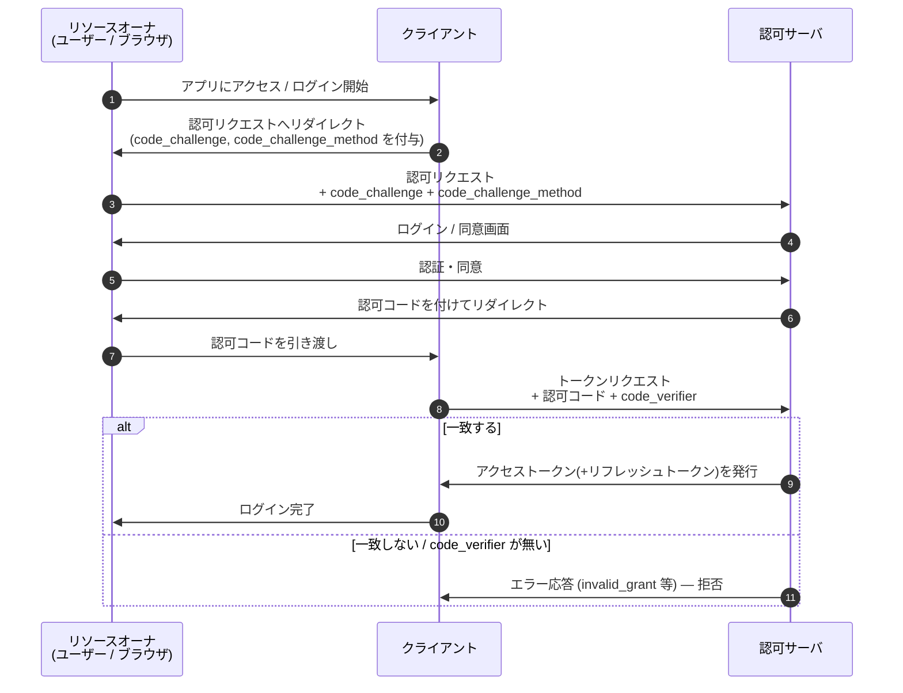

## TL;DR

[[oauth-2|OAuth 2.0]] の認可コードフローで、認可コード横取り攻撃を防ぐための拡張仕様。2015 年 9 月に [[rfc|RFC]] 7636 として標準化され、OAuth 2.1 では必須になっている。

## なぜ必要か

認可コードが攻撃者に横取りされると、攻撃者はそのコードでトークンを取得できてしまう。PKCE では、クライアントが毎回ランダムな秘密値を生成するので、認可リクエストを始めたクライアントと、トークンを受け取るクライアントが同じであることを保証できる。

## 仕組み

クライアントは認可リクエストに `code_challenge` と `code_challenge_method` を付けて送り、トークンリクエストでは認可コードと一緒に `code_verifier` を送る。認可サーバは `code_verifier` を変換した値が `code_challenge` と一致するかを確かめ、一致しなければトークンを発行しない。



### パラメータ

`code_verifier` は、認可リクエストとトークンリクエストを紐づけるためのランダムな文字列である。長さは 43〜128 文字で、英数字と一部の記号（`-`、`.`、`_`、`~`）を使える。十分なエントロピーを確保するために、暗号論的擬似乱数生成器（CSPRNG）で生成する必要がある。

`code_challenge_method` は、`code_verifier` から `code_challenge` を導出するときの変換方法である。推奨は `S256` で、SHA-256 でハッシュ化する。`plain` は変換せずにそのまま使う方法で、OAuth 2.1 では SHA-256 を実行できないクライアント以外は使うべきでないとされている。サポートしていない変換方法を要求されたときは、認可サーバは `invalid_request` エラーを返す必要がある。

```text
S256:  code_challenge = BASE64URL-ENCODE(SHA256(ASCII(code_verifier)))
plain: code_challenge = code_verifier
```

`code_challenge` は、`code_verifier` から導出され、認可リクエストで送られるチャレンジ値である。

%%

## 自分の理解

つまずいた点、腑に落ちたきっかけ。書くときはこのコメントを外す
%%

## 関連

- [[oauth-2|OAuth 2.0]]
- [[oidc|OIDC]]
